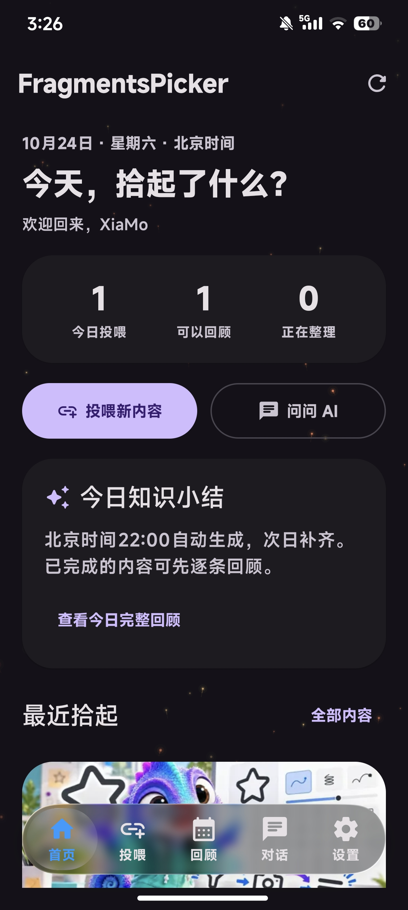
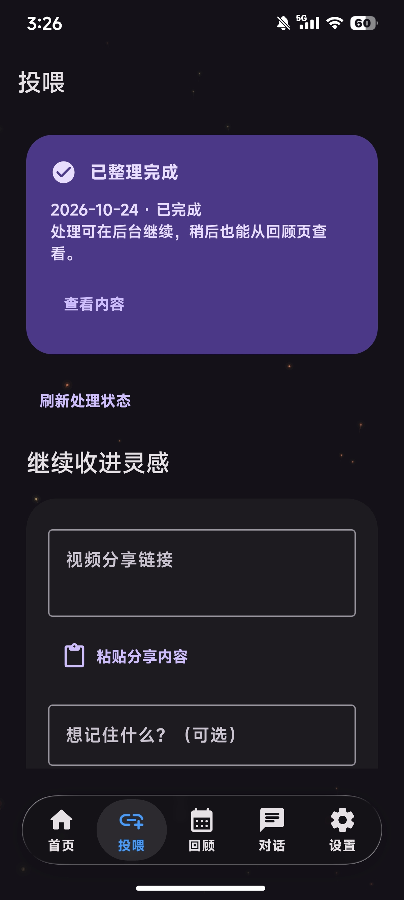
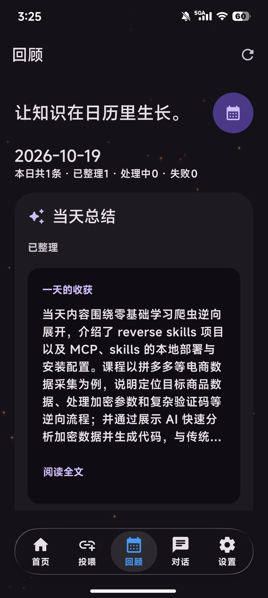
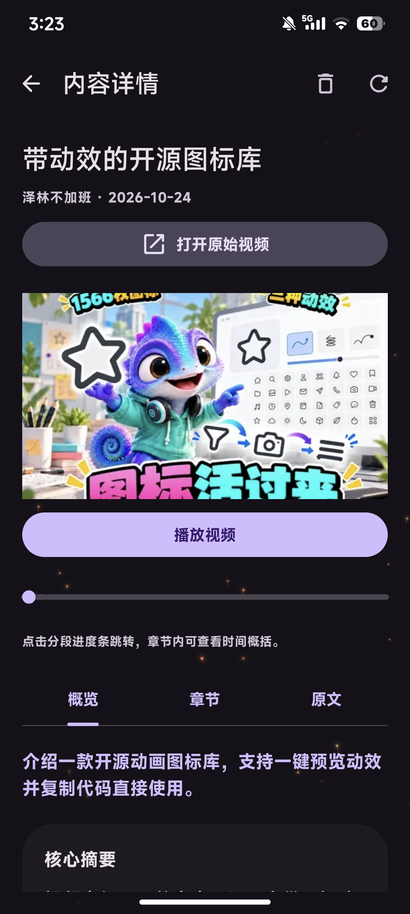
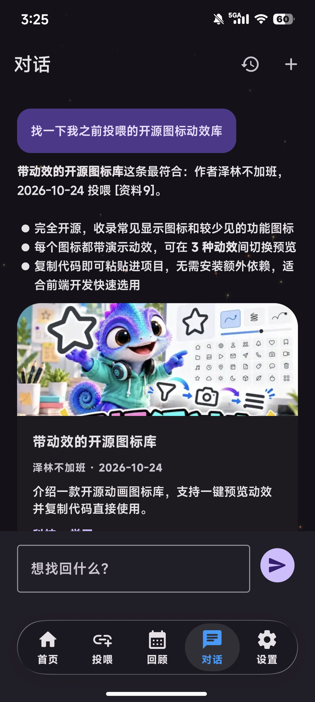
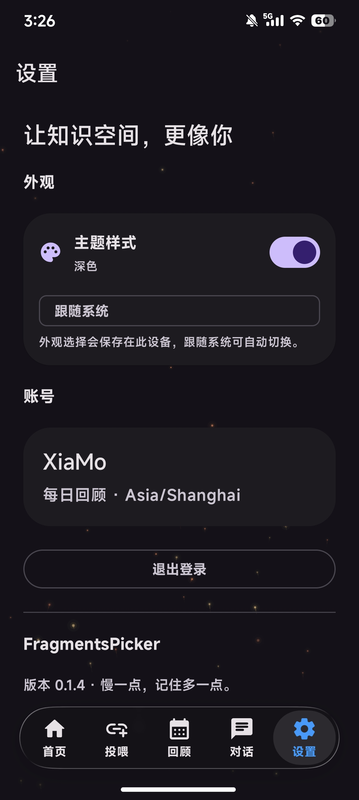

# FragmentsPicker 作品介绍

版本 0.1.4 · 2026年10月24日

## 项目详情与使用方式

FragmentsPicker（简称 FragPicker）是一款 Android 短视频知识整理应用，用于解决内容零散、收藏后难找回的问题。它将保存的视频整理成摘要，支持按日期回顾和 AI 对话检索。

1. 登录账号，粘贴视频分享链接，或通过系统分享投喂。
2. 后台解析、保存并转写视频，生成标题、摘要、要点和关键词。
3. 在首页和回顾页查看内容，在对话页用自然语言寻找历史视频。
4. 进入详情页播放视频、按章节跳转，或打开原始链接。

## 项目亮点

- 信息更轻：先展示短标题与简介，长正文按需展开。
- 找回更快：语义检索结合关键词，回答附相关视频卡片。
- 回顾有序：每天 22:00 生成总结，日历按日期整理内容。
- 体验连贯：液态玻璃导航、主题切换与薪火粒子动效。

## AI 与测试技术落地

AI 应用：通义听悟负责转写，聊天模型负责归纳和对话；本地向量检索与工具调用，让 AI 根据当前用户保存的内容回答。

测试落地：开发中用 AI 辅助梳理用例、编写回归脚本和定位异常。后端采用单元、接口与隔离 MySQL 测试，Android 采用 Compose 设备测试，检查任务状态、卡片相关性、正文展示和主题动画。

## 关键技术

| 模块 | 技术与作用 |
| --- | --- |
| 安卓界面 | Kotlin、Jetpack Compose、Material 3，结合液态玻璃组件与 Markdown 渲染。 |
| 业务后端 | Java 21、Spring Boot、MyBatis-Plus、MySQL，管理账号、内容与任务。 |
| AI 与检索 | LangChain4j 接入 OpenAI 兼容模型，本地 BGE 向量结合关键词检索。 |
| 视频处理 | parse-video-py 解析链接，通义听悟转写，私有 OSS 保存视频与封面。 |
| 工程保障 | JWT 鉴权、Flyway 数据迁移、异步任务和失败重试。 |

## 项目图片

### 首页

今日投喂与知识小结。

### 投喂

链接投喂与处理反馈。

### 回顾

按日期回顾当天内容。

### 内容详情

播放视频，查看章节与原文。

### AI 对话

相关回答与视频来源卡片。

### 设置

外观主题与账号管理。

## 项目与引用

- [项目仓库](https://github.com/Xiamo-vip/FragPicker)
- [AndroidLiquidGlass](https://github.com/Kyant0/AndroidLiquidGlass)
- [parse-video-py](https://github.com/baige778/parse-video-py)
- [LangChain4j](https://github.com/langchain4j/langchain4j)
